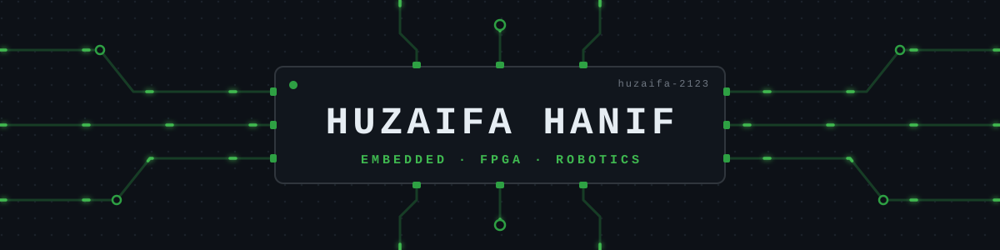

  

  <b>Computer Engineering @ NED University, Karachi</b> 
  I build systems end to end: the circuit, the firmware on it, and the software people use with it.

  
  
  

 

## ⚡ On the bench

<table>
  <tr>
    <td width="50%" valign="top">
      <b>🦾 6-DOF Robotic Arm</b> 
      Hardware bring-up and real-time control
    </td>
    <td width="50%" valign="top">
      <b>🖨️ Custom 3D Printer</b> 
      Frame, electronics and firmware, built from scratch
    </td>
  </tr>
  <tr>
    <td width="50%" valign="top">
      <b>🕹️ Arcade on FPGA</b> 
      An arcade game implemented in Verilog
    </td>
    <td width="50%" valign="top">
      <b>🐧 Linux on RISC-V</b> 
      Booting Linux on a RISC-V core
    </td>
  </tr>
</table>

## 🔩 Built

  
  
  
  

## 🧰 Toolkit

  

  
  
  
  
  
  

## 📈 Signal

  
  

  

